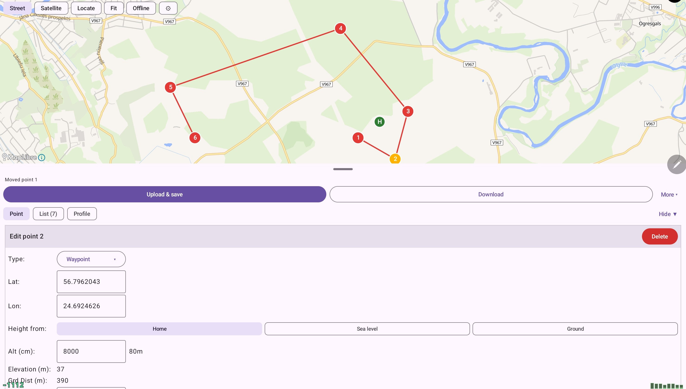
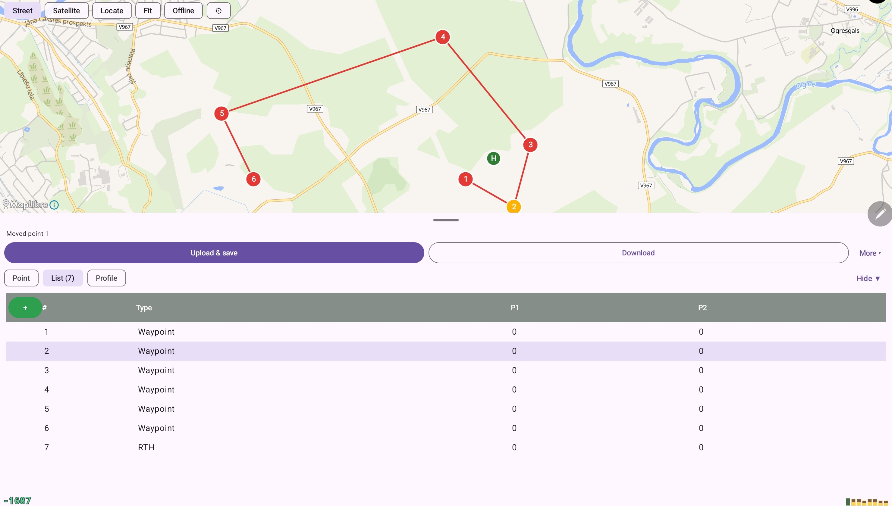
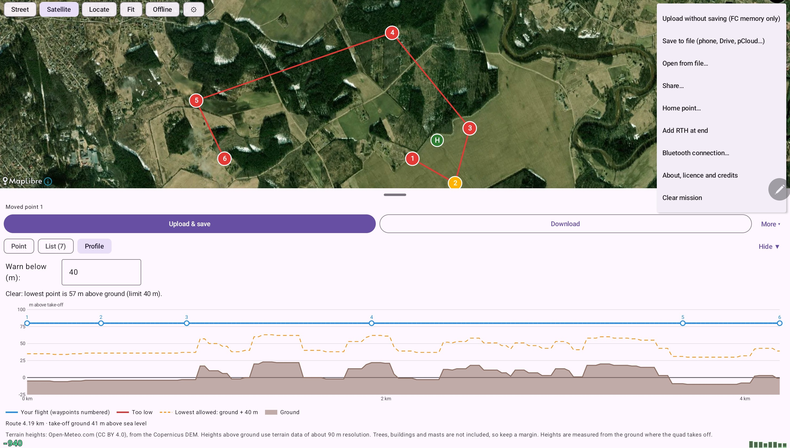

# amission

An unofficial Android app for planning **INAV** waypoint missions and sending them to a flight controller over USB. It exists because there is no official Android mission planner for INAV.

> **Flight-tested.** Missions uploaded with amission have been flown successfully, over both USB and Bluetooth, on a GEPRC TAKER H743 BT running INAV 9.1. Other INAV versions and flight controllers are untested.
>
> **Still early software (v0.1.x)**, written by a single developer. Check every mission before flying (download it again or open it in the INAV Configurator), test with the **props off** first, and stay in control of the aircraft. It comes with no warranty (see [License](#license)). Read [What has been tested](#what-has-been-tested) before trusting it.

amission is not affiliated with or endorsed by the INAV project.

<p align="center">
  
  
  
</p>

## Features

**Plan missions on a map, with or without a quad connected**
- Tap the map to add waypoints, tap a marker to edit it, and the mission is saved on the phone as you go.
- All seven INAV waypoint types (Waypoint, PosHold Time, RTH, Set POI, Jump, Set Head, Land) with the same parameters as the Configurator: speed, hold time, land after RTH, jump target and repeat count, heading, and the four user-action flags.
- Altitude measured from the take-off point (default), from sea level, or as height above the ground under each point. The ground option needs internet the first time (it looks up terrain heights, then keeps them on the phone); a mission with an unresolved ground height cannot be uploaded or saved. New points start at a default altitude you can change (80 m out of the box).

**Talk to the flight controller**
- USB (OTG) or Bluetooth connection (BLE modules such as the one on the GEPRC TAKER H743 BT; Classic SPP modules are supported but untested). Download the mission from the FC, including the one saved in its EEPROM, and upload with an automatic read-back check. Upload saves to EEPROM by default.

**Maps that work in the field**
- Street map with no account or key. Satellite imagery from your own MapTiler or Mapbox key, or any tile URL you are licensed to use.
- **Offline maps:** save an area (Street or Satellite) to the phone before you go, with a size preview before you download, so the map works at the field with no signal. Satellite offline use depends on your provider's terms, and the Street layer follows OpenFreeMap's download limits.
- **Locate** centres the map on the quad's GPS when it has a fix, otherwise on the phone's GPS.

**Safety aids**
- A **Profile** tab plots your planned height against distance, measured from the ground where you take off, with the terrain under it and a colour key, and warns where the quad would be lower than a limit above the ground (40 m by default, adjustable). Uploading a mission with a low stretch asks first.
- A planned take-off (home) point, because relative altitudes count from there.
- A mission check that catches mistakes the flight controller would accept without complaint, such as waypoints placed after an RTH (they are never flown), a Jump to a point that does not exist, or a mission that ends on a Set Head. Uploading asks first.

**Files**
- Save, open and share missions as `.mission` files compatible with the INAV Configurator. The save and open dialogs are Android's own, so Google Drive, pCloud and local storage all work.

## What has been tested

| Verified on a real INAV 9.1 flight controller (GEPRC TAKER H743 BT), over USB and Bluetooth LE | |
|---|---|
| Connect, read mission info | ✅ |
| Download the saved mission (loads it from EEPROM when working memory is empty) | ✅ |
| Upload a mission, with read-back check; the quad flew the waypoints | ✅ (USB and Bluetooth) |
| Read the quad's GPS, with and without a satellite fix | ✅ |
| Bluetooth LE: find the module and connect (an early attempt timed out; a retry was added) | ✅ |

| Verified on an Android emulator and a Samsung phone only (no FC involved) | |
|---|---|
| Map editing, waypoint editor, mission files (save, open, share), offline Street areas, Locate with phone GPS, terrain profile and warning, MapTiler satellite layer | ✅ |
| Offline satellite areas with a real provider; Mapbox and custom tile URLs | ✅ |
| Opening a saved `.mission` file in the INAV Configurator | ✅ |

| **Not verified yet** | |
|---|---|
| Bluetooth Classic (SPP) modules | ❌ |
| Any INAV version other than 9.1, or any other flight controller | ❌ |

Unit tests cover the protocol, the mission file format, the terrain profile and the tile maths (`./gradlew :msp:test`).

## Requirements

- Android 8.0 (API 26) or newer.
- A USB OTG cable to connect the FC, or its Bluetooth module (the FC's Bluetooth UART needs MSP enabled in the Configurator's Ports tab). The USB port must show up as a serial device, which is the default.
- INAV 9.x. Tested only on 9.1, on one flight controller. See [INAV versions](#inav-versions) below.

## INAV versions

This was compared against the INAV source of releases 2.6.0 to 9.1.0. Only **9.1 has been tried on hardware** (a GEPRC TAKER H743 BT, flown with uploaded missions); everything else here is read from the source, not tested.

| INAV version | Expected to work | Why |
|---|---|---|
| **9.0, 9.1** | Yes. 9.1 is tested. | The waypoint commands and format are the same and every feature below exists. |
| **6.0 to 8.x** | Probably, untested. | Same commands and 21-byte waypoint format; the sea-level switch and the four user actions (waypoint flag bits) are defined from 6.0. |
| **5.x** | Basic missions only, untested. | Upload and download use the same commands, and the Jump numbering the app relies on is in place from 5.0. The user actions and the sea-level and Ground height modes may not do what the app says, because the 5.0 source names the absolute-altitude flag differently and that has not been traced. |
| **4.x and older** | Not recommended. | The Jump numbering was not checked, and the newer waypoint flags are missing. |
| **INAV 10 or later** | Unknown. | Not looked at. Check before relying on it. |

What is the same in every release from 2.6 to 9.x: the set-waypoint, read-waypoint, mission-info, mission save and load, and GPS commands, the 21-byte waypoint, and the end-of-mission flag.

The waypoint limit comes from the flight controller, so the app adapts to it. The source default is 15, and common targets raise it to 120.

Not checked on any version: multi-mission setups (the app reads and writes only the first mission, and how each version treats the mission number in save and load was not checked), and forks or custom firmware.

## Install

Download the latest APK from the [Releases page](https://github.com/andrisdru/amission/releases) and install it on the phone (Android will ask you to allow installing from your browser or file manager). Each release lists the file's SHA-256 so you can check it. The APK is signed with the developer's key and is not on Google Play.

### Build from source

```sh
git clone https://github.com/andrisdru/amission.git
cd amission
./gradlew :app:assembleDebug
```

You need a JDK 17 or newer to run Gradle and the Android SDK (platform 36); put the SDK path in `local.properties` as `sdk.dir=...` or open the project in Android Studio. Install `app/build/outputs/apk/debug/app-debug.apk` on the phone.

A signed release build needs your own key: create a keystore, put its path and passwords in a git-ignored `keystore.properties` at the repository root (`storeFile`, `storePassword`, `keyAlias`, `keyPassword`), and run `./gradlew :app:assembleRelease`. Without that file the release is built unsigned. Release builds contain only the arm libraries (about 24 MB); add `-PallAbis` for one that also runs on an x86 emulator. Keep the key and its password safe: an app signed with a different key cannot be installed over an earlier one.

## Using it

1. **Plan.** Tap the map to add points. Drag the small bar above the buttons up or down to give the map or the panel more room; the height is remembered. Press and hold a marker, then drag it to move the point; a touch anywhere else pans the map. Select one to change its type, altitude or other parameters in the **Point** tab; the **List** tab shows the mission as the FC stores it.
2. **Set home.** *More ▸ Home point…* and choose the quad's GPS (needs a fix), the phone's GPS, or the centre of the map. Relative altitudes count from the take-off point, so this makes the **Profile** tab accurate. Without it, home is assumed at point 1.
3. **Check the Profile tab.** Look for the red stretches and the warning.
4. **Connect and upload.** Plug the FC in over OTG, or choose its module in *More ▸ Bluetooth connection* (scan, tap the device, and it tests the link). Then press **Upload & save**. If Bluetooth is selected it is used when no cable is plugged in; a checkbox makes it win even with a cable. Then **Download** it again, or open it in the Configurator, to confirm it is what you planned.

**Satellite imagery** needs an account of your own. Tap **Satellite**, choose MapTiler, Mapbox or a custom tile URL (`https://…/{z}/{x}/{y}`), and paste the key. It is stored on the phone only and is excluded from Android backups. Providers set their own limits, including whether tiles may be saved for offline use; the offline dialog asks you to confirm you checked.

**User actions** (the 1–4 chips) only set flags on a waypoint. They do nothing until you build a *logic condition* in the Configurator's Programming tab that reads "Waypoint user action N".

## Privacy and network use

There are no accounts, ads or analytics. The app talks to these services:

| Service | What is sent | Why |
|---|---|---|
| `tiles.openfreemap.org` | The map area you look at (tile requests) and your IP address | Street map |
| Your satellite provider | The tile area you look at and your key | Satellite imagery, only if you set it up |
| `api.open-meteo.com` | The coordinates of your route and of your home point (which can be your own position if you set it from GPS) | Terrain heights for the Profile tab. Results are cached on the phone |

Location permission is used only when you press **Locate**. Bluetooth needs the *Nearby devices* permission (or location on Android 11 and older) to find and talk to the module; the app does not derive your position from it. Your position is used on the device to centre the map and is not sent anywhere by the app. Missions, settings and the cache stay on the phone.

## Third-party data and terms

- **Street map:** [OpenFreeMap](https://openfreemap.org), [OpenMapTiles](https://openmaptiles.org), data © [OpenStreetMap](https://www.openstreetmap.org/copyright) contributors (ODbL). OpenFreeMap's terms allow apps to offer offline downloads of up to 3,000 tiles or 50 MB each, with at most four parallel requests and an identifying User-Agent. amission follows that; please do too if you change it.
- **Terrain heights:** [Open-Meteo.com](https://open-meteo.com), CC BY 4.0, derived from the Copernicus DEM. The free service is for **non-commercial use** and limited to under 10,000 calls a day. If you build a commercial product from this code, you need your own licence for it. The terrain data is about 90 m resolution and shows bare ground only, **not trees, buildings or masts**.
- **Satellite imagery:** from the provider you choose, under your agreement with them.

## How it works

- `msp/` is plain Kotlin with no Android code: MSP framing, the waypoint and mission operations, the mission file format, the terrain profile and the tile maths. Everything that matters for safety lives here so it can be unit tested without hardware.
- `app/` is the Android app: USB, the MapLibre map, offline areas, location, and the Compose screens.

Protocol behaviour and the file format were checked against the INAV firmware and Configurator source rather than assumed. [`CLAUDE.md`](CLAUDE.md) has the details, including the numbering rules and what is and is not confirmed.

## Limitations

- The mission is shown as the flat list the FC stores. The Configurator instead groups RTH, Jump and Set Head under the previous map point, so point numbers can differ by those entries.
- Only the first mission of a multi-mission file is opened. "PosHold unlimited" is not supported (INAV 9 does not have it).
- MSP v1 only. Fixed-wing landing approaches, safe homes and VTOL options are not edited.

## Contributing

Issues and pull requests are welcome. Run `./gradlew :msp:test` and `./gradlew :app:lintDebug` first. Keep keys, tokens and real flying-site coordinates out of code, tests and commit messages. The project uses GPL-3.0, so contributions are under the same licence.

## License

amission is free software under the **GNU General Public License v3.0**; see [`LICENSE`](LICENSE). It comes with absolutely no warranty. It follows the behaviour of INAV firmware and Configurator, which are also GPL-3.0.

It uses these libraries, all compatible with GPL-3.0:

| Library | Licence |
|---|---|
| MapLibre Native for Android | BSD 2-Clause |
| usb-serial-for-android | MIT |
| OkHttp | Apache 2.0 |
| AndroidX, Jetpack Compose, Kotlin | Apache 2.0 |

INAV is the name of an independent open-source flight controller project; it is used here only to say what this app works with.
